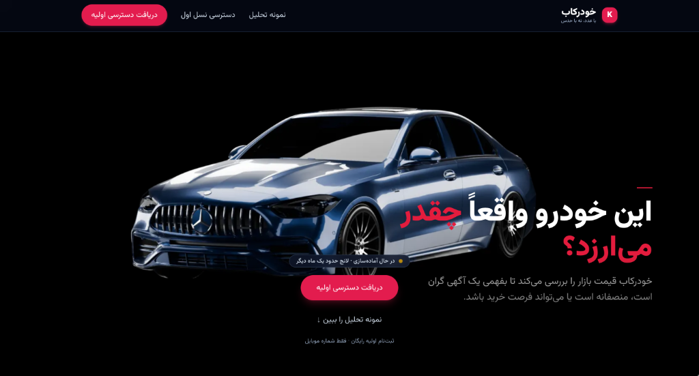
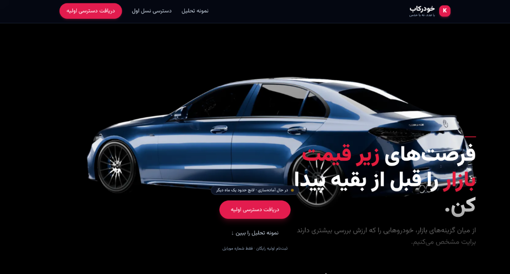
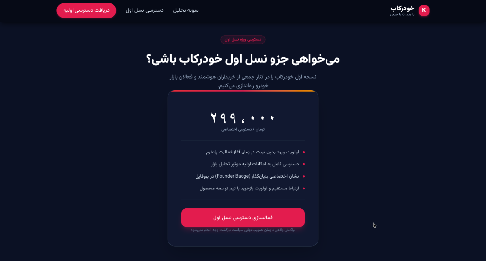
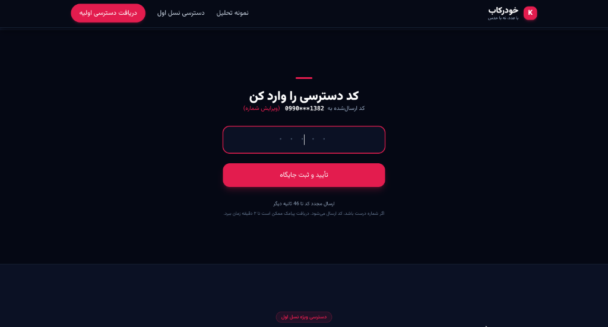
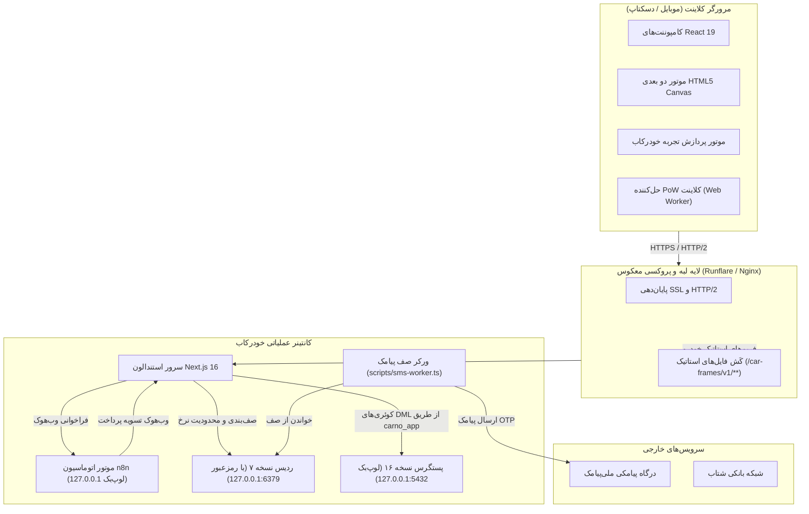

<div align="center" dir="rtl">


# 🚗 خودرکاب (Khodrekab)

<p align="center">
  <a href="README.md">English</a> • <b>فارسی</b>
</p>

[](https://github.com/Mahdi-Soleimani/khodrekab/actions/workflows/ci.yml)
[](https://github.com/Mahdi-Soleimani/khodrekab/actions/workflows/gitleaks.yml)
[](https://github.com/Mahdi-Soleimani/khodrekab/actions/workflows/docker-build.yml)
[](https://github.com/Mahdi-Soleimani/khodrekab/actions/workflows/codeql.yml)
[](https://github.com/Mahdi-Soleimani/khodrekab/actions/workflows/docs-check.yml)
[](https://nextjs.org/)
[](https://react.dev/)
[](https://www.typescriptlang.org/)
[](https://tailwindcss.com/)
[](https://www.postgresql.org/)
[](https://redis.io/)

**پلتفرم مدرن و تعاملی خودرویی با موتور رندر فریم‌های سینماتیک، معماری Zero-Trust و استقرار خودکفا**  
*Next-Generation Interactive Automotive Experience & Pre-order Platform*

[ویژگی‌ها](#-ویژگیهای-کلیدی) • [پیش‌نمایش بصری](#-پیشنمایندگی-بصری-و-محیط-محصول) • [معماری](#-معماری-سامانه) • [مستندات مهندسی](#-مستندات-مهندسی-تفصیلی) • [راه‌اندازی سریع](#-راهاندازی-سریع) • [استقرار عملیاتی](#-استقرار-در-محیط-عملیاتی) • [مشارکت](.github/CONTRIBUTING.md) • [امنیت](.github/SECURITY.md)

</div>

---

## 🌟 نمای کلی (Overview)

**خودرکاب** (`khodrekab.ir`) یک پلتفرم تحت وب با استانداردهای سازمانی و عملکرد بسیار بالاست که با هدف دگرگون‌سازی تجربه نمایشگاه دیجیتال خودرو و مدیریت لیست انتظار و پیش‌خرید هوشمند توسعه یافته است.

خودرکاب با تکیه بر **Next.js 16 (App Router)** و **React 19** ساخته شده و یک موتور کانواس ۱۲۰ فریم ۳۶۰ درجه بدون هیچ‌گونه وابستگی خارجی را با یک معماری امنیتی Zero-Trust، صف‌های پیامکی خودکار پس‌زمینه و تطبیق تراکنش‌های پرداخت کارت‌به‌کارت ترکیب می‌کند.

```text
       نمای جلو (Front Profile)            رینگ‌ها و آیرودینامیک                 نمای عقب و کابین
[ فریم ۰۰۱ ──► ۰۲۰ ]     ──►     [ فریم ۰۲۱ ──► ۰۶۵ ]     ──►     [ فریم ۰۶۶ ──► ۱۲۰ ]
   اسکراب پویا با نرخ ۶۰ فریم • بافر دوگانه کانواس HTML5 • حذف کامل سربار و کرش WebGL
```

---

## 📸 پیش‌نمایش بصری و محیط محصول

<table align="center" width="100%">
  <tr>
    <td width="50%" align="center">
      
      <br />
      <b>موتور ارزیابی منصفانه قیمت خودرو</b>
      <br />
      <sub>بررسی دقیق قیمت بازار برای تمایز خودروهای گران‌قیمت، منصفانه و فرصت‌های خرید</sub>
    </td>
    <td width="50%" align="center">
      
      <br />
      <b>رادار کشف فرصت‌های زیر قیمت بازار</b>
      <br />
      <sub>شناسایی خودکار خودروهایی با ارزش خرید بالا پیش از سایر خریداران</sub>
    </td>
  </tr>
  <tr>
    <td width="50%" align="center">
      
      <br />
      <b>پلن دسترسی نسل اول (Founder Tier)</b>
      <br />
      <sub>اولویت ورود بدون نوبت، نشان اختصاصی بنیان‌گذار و ارتباط مستقیم با تیم فنی</sub>
    </td>
    <td width="50%" align="center">
      
      <br />
      <b>ورود و احراز هویت سریع و امن</b>
      <br />
      <sub>اعتبارسنجی رمز یک‌بارمصرف (OTP) با الگوریتم‌های ضد اسپم و بدون نیاز به کپچا</sub>
    </td>
  </tr>
</table>

---

## ✨ ویژگی‌های کلیدی

### 🏎️ ۱. موتور کانواس تعاملی ۱۲۰ فریم خودرویی
- **پیمایش تصویر WebP بدون نیاز به وب‌جی‌ال:** استفاده از ۱۲۰ فریم از پیش‌رندرشده با شفافیت بالا به‌جای مدل‌های سنگین سه‌بعدی WebGL که مانع از کرش GPU و ناسازگاری شیدرها در دستگاه‌های موبایل می‌شود.
- **تحویل آنی پوستر با SSR:** فریم نخست مستقیماً از سمت سرور رندر می‌شود تا هرگونه جابه‌جایی چیدمان (CLS = 0) از بین برود و نخستین ترسیم محتوا (FCP) آنی باشد.
- **آبرسانی گام‌به‌گام (Progressive Stride Hydration):** پیش‌بارگذاری ۵ فریم کلیدی مبنا (`1`، `30`، `60`، `90`، `120`) با اولویت بالا (`fetchpriority="high"`) و سپس دانلود در گام‌های ۴ و ۲ در پس‌زمینه.
- **مدیریت تطبیقی حافظه:** دیکود سخت‌افزاری با `createImageBitmap()` و کش با الگوریتم LRU که در دسکتاپ به ۲۵۶ مگابایت و در موبایل به ۱۲۸ مگابایت محدود شده است.

### 🛡️ ۲. معماری امنیتی Zero-Trust و ضد سوءاستفاده
- **اثبات کار سمت کلاینت (Proof-of-Work):** چالش رمزنگاری مبتنی بر SHA-256 در یک Web Worker پیش از ارسال درخواست به اندپوینت‌های حساس اجرا می‌شود تا حملات ربات‌ها را بدون ایجاد اصطکاک کپچا متوقف کند.
- **فیوزهای ایمنی مالی (Financial Circuit Breakers):** محدودکننده‌های نرخ چندلایه در ردیس با سقف‌های ساعتی و روزانه، مانع از تخلیه بودجه پیامک در اثر حملات انبوه می‌شوند.
- **رمزنگاری اطلاعات شناسایی (PII) در حالت سکون:** شماره‌های همراه با استاندارد **AES-256-GCM** همراه با اندیس کور HMAC-SHA256 ذخیره می‌شوند تا جستجوی سریع $O(1)$ بدون نگهداری متن خام در پایگاه‌داده میسر باشد.
- **حداقل اختیارات در PostgreSQL:** تفکیک قطعی نقش اجرای تراکنش‌ها (`carno_app`) از نقش مهاجرت اسکیمای دیتابیس (`carno_migrator`).

### 💳 ۳. تسویه و تطبیق خودکار پرداخت کارت‌به‌کارت
- **تطبیق وب‌هوک با شناسه عددی یکتا:** پردازش خودکار پیامک‌های بانکی توسط n8n از طریق محاسبه آفست عددی منحصربه‌فرد (مثلاً `۲۹۹,۰۰۰ + ۳۴۷` تومان).
- **قفل‌گذاری بدبینانه در سطح سطر (Pessimistic Locking):** ایزولاسیون با `SELECT ... FOR UPDATE` مانع از بروز شرایط رقابتی (Race Conditions) هنگام پرداخت‌های همزمان و ثبت رفرال‌ها می‌شود.
- **شمارشگر معکوس فعال ۱۵ دقیقه‌ای:** همگام‌سازی لحظه‌ای وضعیت با انقضای خودکار در صورت عدم پرداخت.

### 🇮🇷 ۴. بومی‌سازی جامع برای بازار ایران و تایپوگرافی
- چیدمان راست‌چین (RTL) بهینه با فونت متغیر **وزیرمتن (Vazirmatn)**.
- اتصال مستقیم به درگاه پیامک **ملی‌پيامک** با پترن‌های کم‌تأخیر خدماتی (`BaseServiceNumber`).
- اعتبارسنجی کدملی، شماره همراه ایرانی (`+98` / `09xx`) و شماره کارت‌های عضو شبکه بانکی شتاب.

---

## 🏛 معماری سامانه

سامانه خودرکاب به‌گونه‌ای مهندسی شده که یک پکیج خودکفا، بسیار پایدار و ایزوله باشد. در محیط عملیاتی، سرویس‌های PostgreSQL، Redis، n8n و سرور Next.js داخل یک کانتینر مجتمع قرار دارند و ارتباط آن‌ها از طریق سوکت‌های لوپ‌بک احراز هویت شده (`127.0.0.1`) انجام می‌پذیرد:



---

## 📚 مستندات مهندسی تفصیلی

در پوشه `docs/` مشخصات فنی دقیق، آزمایش‌شده و اعتبارسنجی‌شده قرار دارد:

- 🏛 **[معماری سیستم (System Architecture)](docs/architecture.md):** توپولوژی اجزا، مکانیزم تحویل بهینه فریم‌ها و ارکستراسیون کانتینر.
- 🛡️ **[معماری امنیت (Security Architecture)](docs/security.md):** اثبات کار (PoW)، رمزنگاری داده‌های حساس با AES-GCM، محدودکننده‌های نرخ و قواعد CSP.
- 🗄️ **[پایگاه‌داده و همروندی (Database & Concurrency)](docs/database.md):** مدل‌های داده‌ای Prisma، ایزولاسیون تراکنش‌ها، قفل‌های بدبینانه و ایندکس‌های مرکب.
- 🔄 **[ماشین‌های وضعیت (State Machines)](docs/state-machine.md):** دیاگرام‌های حالت FSM برای انیمیشن اسکرول، احراز هویت پیامکی و فرآیند پرداخت.
- ⚡ **[مهندسی کارایی و عملکرد (Performance Engineering)](docs/performance.md):** بهینه‌سازی‌های موتور کانواس دو بعدی، بودجه‌بندی حافظه LRU و شاخص‌های Core Web Vitals.

---

## 🚀 راه‌اندازی سریع

### پیش‌نیازها
- **Node.js:** نسخه v24.x (LTS)
- **مدیریت پکیج:** `npm` (یا `pnpm`)
- **Docker و Docker Compose:** برای اجرای لوکال سرویس‌های دیتابیس و ردیس

### ۱. کلون و نصب وابستگی‌ها
```bash
git clone https://github.com/Mahdi-Soleimani/khodrekab.git
cd khodrekab
npm install
```

### ۲. پیکربندی متغیرهای محیطی
قالب نمونه متغیرهای محیطی را کپی کنید:
```bash
cp .env.example .env
```
مقادیر موردنیاز را در فایل `.env` پر کنید (تولید کلیدهای امنیتی با `openssl rand -hex 32`).

### ۳. راه‌اندازی سرویس‌های محلی
سرویس‌های PostgreSQL و Redis را اجرا نمایید:
```bash
docker compose up -d postgres redis
```

### ۴. آماده‌سازی دیتابیس و رول‌ها
اسکریپت تعریف رول‌ها با کمترین دسترسی و اجرای مایگریشن‌ها:
```bash
# ایجاد رول‌های امنیتی
psql -h localhost -p 5433 -U postgres -d carlanding -f prisma/bootstrap-roles.sql

# اجرای مایگریشن‌های پریزما
npx prisma migrate dev
```

### ۵. اجرای سرور توسعه
```bash
npm run dev
```
آدرس [http://localhost:3000](http://localhost:3000) را در مرورگر باز کنید.

---

## 📦 ساختار پروژه

```text
khodrekab/
├── docs/                        # مستندات مهندسی تفصیلی و اسناد فنی
│   ├── architecture.md          # معماری کلی سیستم و مکانیزم تحویل فریم‌ها
│   ├── security.md              # معماری Zero-Trust، اثبات کار و رمزنگاری
│   ├── database.md              # مدل‌های پریزما و پروتکل همروندی
│   ├── state-machine.md         # ماشین‌های حالت FSM برای اسکرول، پیامک و پرداخت
│   ├── performance.md           # بهینه‌سازی کانواس و معیارهای Core Web Vitals
│   └── images/                  # تصاویر، بنر و پیش‌نمایش‌های محیط محصول
├── public/                      # دارایی‌های استاتیک و رسانه‌ای
│   ├── car-frames/v1/           # ۱۲۰ فریم دسکتاپ + ۱۲۰ فریم موبایل WebP با manifest.json
│   └── images/                  # نشان‌ها، آواتارها و تصاویر رابط کاربری
├── src/
│   ├── app/                     # روت‌های نکست‌جی‌اس (صفحات و هندلرهای API)
│   │   ├── api/                 # اندپوینت‌های امن REST (احراز هویت، پرداخت، لیست انتظار)
│   │   ├── dashboard/           # داشبورد کاربران احراز هویت‌شده
│   │   ├── payment/             # ثبت تراکنش و تسویه کارت‌به‌کارت
│   │   └── page.tsx             # صفحه اصلی فرود تعاملی
│   ├── components/              # کامپوننت‌های مشترک رابط کاربری و سیستم دیزاین
│   ├── features/
│   │   ├── khodrekab-dashboard/ # کارت عضویت، رهگیری رفرال و آمارها
│   │   └── khodrekab-experience/# موتور کانواس ۱۲۰ فریم، لودر و کش LRU
│   └── lib/                     # امنیت، محدودکننده نرخ ردیس، کلاینت پیامک و دیتابیس
├── prisma/                      # تعریف اسکیما و مایگریشن‌های SQL
├── deploy/                      # قالب‌های سرویس Systemd و تنظیمات استقرار
├── Dockerfile                   # ایمیج چندمرحله‌ای بهینه‌شده عملیاتی
├── entrypoint.sh                # سرپرست و ارکستریتور کانتینر در حالت لوپ‌بک
└── .gitleaks.toml               # قوانین سفارشی شناسایی نشت اطلاعات با قوانین شتاب
```

---

## 🔒 ممیزی امنیت و انطباق

خودرکاب سازوکار خودکار تشخیص نشت اطلاعات و سکرت‌ها را در هر کامیت اعمال می‌کند:
- **هوک Pre-Commit:** مدیریت‌شده از طریق `.pre-commit-config.yaml` و `.git/hooks/pre-commit`.
- **قواعد سفارشی:** تنظیم‌شده در `.gitleaks.toml` برای شناسایی کارت‌های عضو شتاب، توکن‌های وب‌هوک n8n و کلیدهای خصوصی API.
- **GitHub Actions:** اسکن‌های یکپارچه‌سازی مداوم (CI) که در هر پوش روی شاخه `main` به‌صورت خودکار اجرا می‌شوند.

اجرای اسکن امنیتی به‌صورت محلی:
```bash
gitleaks detect --config=.gitleaks.toml --verbose
```

---

## 🚢 استقرار در محیط عملیاتی

خودرکاب برای استقرار ابری در پلتفرم‌هایی نظیر **Runflare**، **Fly.io** یا هر سرور مجازی سازگار با داکر مهندسی شده است.

### ساخت و اجرای کانتینر مستقل
```bash
# ساخت ایمیج عملیاتی
docker build -t khodrekab:latest .

# اجرا همراه با مانت دیتای پایدار
docker run -d \
  --name khodrekab-app \
  -p 3000:3000 \
  -v khodrekab-data:/var/lib/carno-data \
  --env-file .env \
  khodrekab:latest
```

---

## 🤝 مشارکت و توسعه

مشارکت‌های شما به پیشرفت جامعه توسعه‌دهندگان و مهندسی نرم‌افزار کمک شایانی می‌کند. از هرگونه مشارکت، گزارش باگ یا ارائه پیشنهاد صمیمانه استقبال می‌کنیم.

- 📖 **راهنمای مشارکت:** لطفاً [راهنمای مشارکت](.github/CONTRIBUTING.md) را جهت آگاهی از استانداردهای کد، نام‌گذاری برنچ‌ها و کامیت‌های معنادار مطالعه فرمایید.
- 🛡️ **سیاست امنیت:** جهت گزارش محرمانه آسیب‌پذیری‌های امنیتی، لطفاً [سیاست امنیت](.github/SECURITY.md) را بررسی کنید.
- 🐛 **ثبت بازخورد و باگ:** خطاها و پیشنهادات قابلیت‌های جدید را در [فرم‌های Issue گیت‌هاب](https://github.com/Mahdi-Soleimani/khodrekab/issues/new/choose) ثبت نمایید.

---

## 📄 مجوز و مالکیت معنوی

کلیه حقوق متعلق به تیم خودرکاب (Khodrekab) است. © ۲۰۲۶  
کد منبع این پروژه به‌منظور ارزیابی، مرجع فنی و اهداف آموزشی منتشر شده است.
