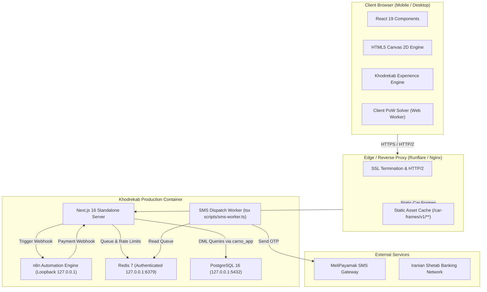

# 🚗 Khodrekab (خودرکاب)

<div align="center">

[](https://nextjs.org/)
[](https://react.dev/)
[](https://www.typescriptlang.org/)
[](https://tailwindcss.com/)
[](https://www.postgresql.org/)
[](https://redis.io/)
[](https://github.com/gitleaks/gitleaks)

**Next-Generation Interactive Automotive Experience & Pre-order Platform**  
*پلتفرم مدرن و تعاملی خودرویی با موتور رندر فریم‌های سینماتیک، معماری Zero-Trust و استقرار خودکفا*

[Features](#-key-features) • [Architecture](#-architecture) • [Quickstart](#-quickstart) • [Engineering Docs](#-engineering-deep-dives) • [Deployment](#-deployment)

</div>

---

## 🌟 Overview

**Khodrekab** (`khodrekab.ir`) is a production-grade, high-performance web platform designed to revolutionize automotive digital showrooming and pre-order waitlists. 

Engineered with **Next.js 16 (App Router)** and **React 19**, Khodrekab combines a zero-runtime-dependency 120-frame 360-degree car canvas engine with an enterprise-grade Zero-Trust security model, automated SMS queue workers, and resilient card-to-card payment reconciliation.

```
       Front Profile               Wheels & Aero              Rear Stance & Cabin
[ Frame 001 ──► 020 ]  ──►  [ Frame 021 ──► 065 ]  ──►  [ Frame 066 ──► 120 ]
   Dynamic Scroll Scrubbing at 60 FPS • Dual Buffer HTML5 Canvas • Zero WebGL Overhead
```

---

## ✨ Key Features

### 🏎️ 1. Interactive 120-Frame Automotive Canvas
- **Pure WebP Image Scrubbing:** 120 high-fidelity pre-rendered transparent frames instead of heavy 3D WebGL models, eliminating client GPU crashes and shader rendering discrepancies.
- **SSR Eager Poster Handoff:** Server-rendered Frame 1 eliminates layout shift (CLS = 0) and delivers instant First Contentful Paint.
- **Progressive Stride Hydration:** Preloads 5 anchor keyframes (`1`, `30`, `60`, `90`, `120`) with `fetchpriority="high"`, followed by stride-4 and stride-2 background loading.
- **Adaptive Memory Management:** Hardware-accelerated `createImageBitmap()` decodes with an LRU cache capped at 256MB on desktop and 128MB on mobile.

### 🛡️ 2. Zero-Trust Security & Anti-Abuse
- **Client-Side Proof-of-Work (PoW):** Cryptographic SHA-256 challenge computed in a Web Worker before sensitive API endpoints, stopping automated bot attacks without CAPTCHA friction.
- **Financial Circuit Breakers:** Multi-tiered Redis rate limiters enforce strict hourly/daily caps on SMS delivery to eliminate bill-draining attacks.
- **PII Encryption at Rest:** Phone numbers are encrypted using **AES-256-GCM** with a blind HMAC-SHA256 index for $O(1)$ searchability without plaintext database persistence.
- **PostgreSQL Least Privilege:** Strict role separation between runtime DML (`carno_app`) and CI/CD schema migrations (`carno_migrator`).

### 💳 3. Card-to-Card Payment Reconciliation
- **Automated Webhook Reconciliation:** Parses incoming bank transaction notifications via n8n with an algorithmic unique integer offset (e.g. `299,000 + 347` Tomans).
- **Pessimistic Row-Level Locking:** `SELECT ... FOR UPDATE` isolation prevents race conditions during concurrent payments and referral attribution.
- **Active 15-Minute Countdown:** Real-time state synchronization with automatic expiration.

### 🇮🇷 4. Iran-First Localization & Typography
- Native RTL layout powered by the **Vazirmatn** variable font.
- Integrated SMS gateway via **MeliPayamak** using low-latency `BaseServiceNumber` OTP patterns.
- Normalized Iranian national ID, phone number formatting (`+98` / `09xx`), and Shetab bank card validation.

---

## 🏛 Architecture

Khodrekab is built as a self-contained, highly resilient system. The production environment bundles PostgreSQL, Redis, n8n, and Next.js into a single container operating over authenticated Unix loopback sockets (`127.0.0.1`):



---

## 📚 Engineering Deep Dives

The `docs/` directory contains comprehensive, mathematically verified specifications:

- 🏛 **[System Architecture](docs/architecture.md):** Complete component topology, frame delivery mechanics, and container orchestration.
- 🛡️ **[Security Architecture](docs/security.md):** Proof-of-Work specification, AES-GCM PII encryption, rate limiters, and CSP rules.
- 🗄️ **[Database & Concurrency](docs/database.md):** Prisma data models, transaction isolation, pessimistic locking, and composite indexes.
- 🔄 **[State Machines](docs/state-machine.md):** Formal finite state machines for scroller animation, OTP onboarding, and payment processing.
- ⚡ **[Performance Engineering](docs/performance.md):** Canvas 2D engine optimizations, LRU memory budgeting, and Core Web Vitals targets.

---

## 🚀 Quickstart

### Prerequisites
- **Node.js:** v20.x or higher
- **Package Manager:** `npm` (or `pnpm`)
- **Docker & Docker Compose:** For running local PostgreSQL and Redis

### 1. Clone & Install Dependencies
```bash
git clone https://github.com/Mahdi-Soleimani/khodrekab.git
cd khodrekab
npm install
```

### 2. Configure Environment Variables
Copy the sanitized environment template:
```bash
cp .env.example .env
```
Update the required secrets in `.env` (generate keys with `openssl rand -hex 32`).

### 3. Spin Up Local Services
Launch local PostgreSQL and Redis instances:
```bash
docker compose up -d postgres redis
```

### 4. Initialize Database & Roles
Run the initial bootstrap and schema migrations:
```bash
# Bootstrap least-privilege roles
psql -h localhost -p 5433 -U postgres -d carlanding -f prisma/bootstrap-roles.sql

# Execute Prisma migrations
npx prisma migrate dev
```

### 5. Start Development Server
```bash
npm run dev
```
Open [http://localhost:3000](http://localhost:3000) in your browser.

---

## 📦 Project Structure

```text
khodrekab/
├── docs/                        # Engineering specifications & deep dives
│   ├── architecture.md          # System architecture & asset delivery
│   ├── security.md              # Zero-Trust model, PoW & cryptography
│   ├── database.md              # Prisma models & concurrency protocol
│   ├── state-machine.md         # FSMs for scroller, OTP & payment
│   └── performance.md           # Canvas optimization & Core Web Vitals
├── public/                      # Static assets & public media
│   ├── car-frames/v1/           # 120 Desktop + 120 Mobile WebP frames + manifest.json
│   └── images/                  # Badges, avatars, and UI graphics
├── src/
│   ├── app/                     # Next.js App Router (pages & route handlers)
│   │   ├── api/                 # Secure REST endpoints (auth, payment, waitlist)
│   │   ├── dashboard/           # Authenticated user dashboard
│   │   ├── payment/             # Payment intent & card-to-card checkout
│   │   └── page.tsx             # Main interactive landing page
│   ├── components/              # Shared UI components & design system
│   ├── features/
│   │   ├── khodrekab-dashboard/ # Membership card, referral tracking & stats
│   │   └── khodrekab-experience/# 120-frame canvas engine, loader & LRU cache
│   └── lib/                     # Security, Redis rate limiters, SMS & db client
├── prisma/                      # Schema definition & SQL migrations
├── deploy/                      # Systemd service templates & deployment configs
├── Dockerfile                   # Multi-stage production container build
├── entrypoint.sh                # Container supervisor & loopback orchestrator
└── .gitleaks.toml               # Custom Gitleaks configuration with Shetab rules
```

---

## 🔒 Security Audit & Compliance

Khodrekab enforces automated secret detection on every commit:
- **Pre-Commit Hook:** Managed via `.pre-commit-config.yaml` and `.git/hooks/pre-commit`.
- **Custom Rules:** Configured in `.gitleaks.toml` with detection for Iranian Shetab bank cards, n8n webhook tokens, and private API keys.
- **GitHub Actions:** Continuous integration scans run automatically on every push to `main`.

Run a local security scan at any time:
```bash
gitleaks detect --config=.gitleaks.toml --verbose
```

---

## 🚢 Production Deployment

Khodrekab is optimized for deployment on **Runflare**, **Fly.io**, or any standard Docker-compatible VPS.

### Build and Run Standalone Container
```bash
# Build production image
docker build -t khodrekab:latest .

# Run with persistent volume mount
docker run -d \
  --name khodrekab-app \
  -p 3000:3000 \
  -v khodrekab-data:/var/lib/carno-data \
  --env-file .env \
  khodrekab:latest
```

---

## 📄 License & Intellectual Property

Copyright © 2026 Khodrekab Team. All rights reserved.  
The source code is published for evaluation, reference, and educational purposes.
