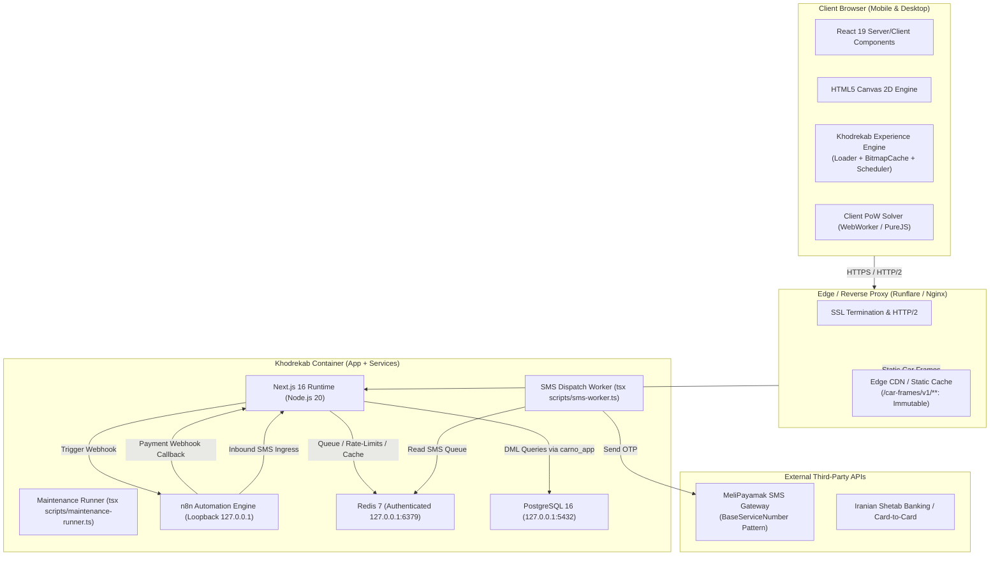
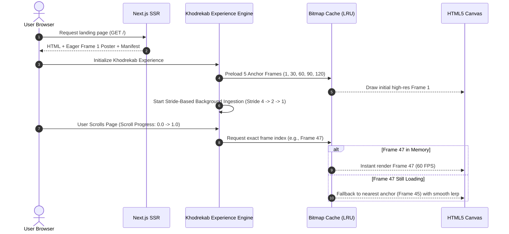

# Khodrekab System Architecture

[← Back to README](../README.md) • **Architecture** • [Security](security.md) • [Database](database.md) • [State Machine](state-machine.md) • [Performance](performance.md)

---

## 1. High-Level Architecture Overview

Khodrekab is designed around three primary pillars:
1. **Ultra-Smooth Automotive Visualization:** A zero-runtime-dependency 120-frame WebP sequence rendered onto an HTML5 Canvas, driven by scroll progress with 60 FPS performance on both mobile and desktop.
2. **Zero-Trust Security & Anti-Abuse:** Multi-layered defense incorporating client-side Proof-of-Work (PoW), Redis sliding-window rate limiters, AES-GCM-256 PII encryption, and least-privilege PostgreSQL role separation.
3. **Resilient Local-First Infrastructure:** A self-contained single-container deployment topology where PostgreSQL, Redis, n8n, and Next.js run seamlessly over authenticated Unix loopback sockets and persistent volume mounts.

---

## 2. Interactive Automotive 120-Frame Engine

Rather than relying on heavy WebGL libraries (Three.js/Babylon) that consume excessive GPU memory, drain battery, and suffer from variable model shading across mobile chipsets, Khodrekab uses a **pre-rendered, high-fidelity 120-frame WebP image sequence**.

### 2.1 Asset Profiles & Dimensions
Assets are segregated into two responsive profiles defined in `public/car-frames/v1/manifest.json`:
- **Desktop Profile:** 1600×900 px, WebP format, quality 80, transparent RGBA with baked floor ambient occlusion shadow.
- **Mobile Profile:** 960×540 px, WebP format, quality 75, optimized for mobile cellular connections and reduced memory footprint.
- **Asset Size:** The entire 120-frame mobile sequence is under 6.5 MB, and desktop is under 7.5 MB.

### 2.2 Progressive Frame Delivery Layer
To eliminate blank canvas flashes and layout shifts during initial load:
1. **SSR Eager Poster Handoff:** The server renders an eager `` tag with Frame 1 as an immediate poster.
2. **Anchor Frame Preload:** Frames `1`, `30`, `60`, `90`, and `120` are loaded first with `fetchpriority="high"`. This enables instant coarse 360-degree rotation even before intermediate frames finish downloading.
3. **Stride-Based Progressive Hydration:** Remaining frames are fetched in descending stride intervals (stride 4 $\to$ stride 2 $\to$ stride 1) via a priority-managed `LoadQueue`.
4. **Bitmap Memory Management:** Frames are decoded into memory via `createImageBitmap()` (or `Image` elements as fallback) and stored in an LRU memory cache with a strict budget cap (256 MB desktop, 128 MB mobile).

---

## 3. Security & Anti-Abuse Architecture

Khodrekab implements an enterprise-grade Zero-Trust security perimeter specifically designed to defend against automated registration bots, SMS balance exhaustion attacks, and unauthorized database access.

### 3.1 Proof-of-Work (PoW) Challenge
Before any sensitive endpoint (`/api/auth/otp/send`, `/api/waitlist`) accepts user input:
- The server issues a cryptographic challenge containing a timestamp, unique nonce, and target difficulty.
- The client computes a SHA-256 hash matching the difficulty target using a background Web Worker (with pure-JS fallback).
- The solution is verified atomically on the server before any SMS gateway call or database transaction is initiated.

### 3.2 SMS Rate Limiting & Financial Guardrails
- **Per-IP Rate Limit:** Maximum 20 SMS requests per hour per `/32` IP address.
- **Per-Phone Rate Limit:** Maximum 10 verification requests per 24 hours per Iranian mobile number.
- **Global Budget Cap:** System-wide hourly and daily caps prevent catastrophic billing spikes in case of distributed attacks.
- **Exponential Lockout:** 10 consecutive invalid OTP attempts trigger an automatic 30-minute lockout in Redis.

### 3.3 Database Role Separation (Least Privilege)
The application enforces strict PostgreSQL role separation defined in `prisma/bootstrap-roles.sql`:
- **`carno_app`:** Strictly granted `SELECT`, `INSERT`, `UPDATE`, and `DELETE` on application tables. Has zero `DDL` rights (cannot drop tables, alter schemas, or truncate data).
- **`carno_migrator`:** Possesses schema alteration rights, used exclusively during CI/CD deployment runs via `prisma migrate deploy`.

---

## 4. State Synchronization & Machine Flow

The platform coordinates complex asynchronous user journeys through explicit finite state machines:
1. **Interactive Car Narrative:** 6 cinematic scenes synchronized with the car's 360-degree rotation (Hero Profile $\to$ Precision Wheels $\to$ Aerodynamic Roofline $\to$ Rear Profile $\to$ Interior Cabin $\to$ Call to Action).
2. **Lead Qualification & Reservation:** Multi-step wizard capturing car preferences, delivery readiness, and contact details with instant optimistic UI validation.
3. **Card-to-Card Payment Flow:** Secure payment intent creation with 15-minute countdown timer, automated SMS transaction parsing via n8n, and atomic state transition from `PENDING` to `CONFIRMED`.

---

## 5. Deployment Topology (Single-Container & Multi-Service)

Khodrekab supports two deployment configurations:

### 5.1 Production Single-Container Architecture (Runflare / PaaS)
Optimized for streamlined PaaS hosting with zero external database dependencies:
- **Base Image:** `node:20-bookworm-slim` with PostgreSQL 16, Redis 7, and n8n pre-installed.
- **Process Orchestration:** Handled via [entrypoint.sh](../entrypoint.sh) with graceful shutdown traps (`SIGTERM`/`SIGINT`).
- **Data Persistence:** All databases, uploaded media, and configuration keys reside in the persistent mount `/var/lib/carno-data`.
- **Network Isolation:** Internal services bind strictly to `127.0.0.1`. Only Next.js port `3000` is exposed to the reverse proxy.

### 5.2 Multi-Container Docker Compose Architecture
Used for local development and scalable multi-node cloud environments:
- `postgres`: Official PostgreSQL 16 Alpine with healthchecks.
- `redis`: Redis 7 Alpine with authenticated connection.
- `app`: Next.js production standalone server.
- `n8n`: Dedicated automation worker container with volume mounts.
- `sms-worker`: Standalone background worker consuming Redis queues.
