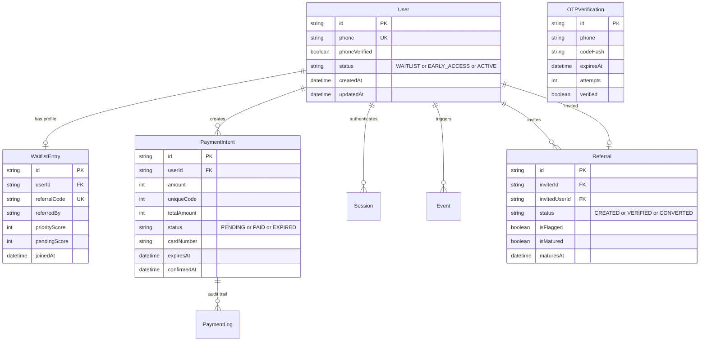

# Khodrekab Database Model & Concurrency Protocol

[← Back to README](../README.md) • [Architecture](architecture.md) • [Security](security.md) • **Database** • [State Machine](state-machine.md) • [Performance](performance.md)

---

## 1. Entity-Relationship Overview

The database schema manages user lifecycles, waitlist priority scoring, OTP verifications, anti-abuse counters, payment intents, and referral attribution trees.



---

## 2. Core Entities & Lifecycle

### 2.1 `User` & `WaitlistEntry`
- **Phone Uniqueness:** `User.phone` stores an encrypted string, while lookups leverage the SHA-256 blind index pepper.
- **Priority Scoring:** Users start with a base priority score of `10`. Each verified referral adds to `pendingScore`, which converts to `priorityScore` once mature.
- **Ordered Queue Index:** Composite index `@@index([priorityScore(sort: Desc), joinedAt(sort: Asc)])` allows $O(1)$ retrieval of waitlist position rankings without sequential table scans.

### 2.2 `PaymentIntent` & Unique Offset Reconciliation
For card-to-card payments without costly direct merchant POS APIs:
- Each user is assigned a temporary randomized integer offset `uniqueCode` between `1` and `999` (e.g. `299,000` + `347` = `299,347` Tomans).
- When a bank SMS notification arrives via n8n webhook, the system matches the exact `totalAmount` on `status = 'PENDING'`.
- Index `@@index([status, totalAmount])` resolves the transaction match in $< 2\text{ ms}$.

---

## 3. Concurrency Protocol & Pessimistic Locking

High-traffic registration surges and simultaneous webhook receipts present race conditions. Khodrekab prevents double-counting and inventory desynchronization using PostgreSQL row-level locks.

### 3.1 Referral Attribution Locking
When an invited user verifies their mobile number, the referrer's score must be incremented atomically:

```sql
-- Executed inside an interactive Prisma $transaction with RepeatableRead isolation
SELECT id, "priorityScore", "pendingScore"
FROM "WaitlistEntry"
WHERE "userId" = $1
FOR UPDATE; -- Row-level exclusive lock blocks concurrent updates

UPDATE "WaitlistEntry"
SET "pendingScore" = "pendingScore" + 5
WHERE "userId" = $1;
```

### 3.2 Payment Webhook Deduplication
Payment confirmation webhooks from n8n or payment gateways are inherently idempotent:
1. The transaction acquires an exclusive lock on `PaymentIntent` matching `id` or `(status, totalAmount)`.
2. If `status` is already `PAID`, the webhook immediately returns `200 OK` with an idempotency acknowledgment.
3. If `PENDING`, the state transitions to `PAID`, `confirmedAt` is stamped, and the associated `User.status` transitions to `EARLY_ACCESS` within the same atomic transaction.

---

## 4. Performance Indexing Strategy

Composite indexes are carefully tailored to avoid redundant b-trees while covering all critical query patterns:

| Table | Index Columns | Purpose |
| :--- | :--- | :--- |
| `WaitlistEntry` | `(priorityScore DESC, joinedAt ASC)` | Dynamic leaderboard & rank position calculation |
| `PaymentIntent` | `(status, totalAmount)` | Instant SMS webhook reconciliation |
| `PaymentIntent` | `(userId)` | User dashboard payment history |
| `OTPVerification`| `(phone, verified)` | Active verification code lookup |
| `Referral` | `(inviterId, isMatured, maturesAt)` | Batch maturation cron worker |
| `Referral` | `(inviterId, createdAt)` | Referral abuse & velocity detection |
| `Session` | `(userId, createdAt DESC)` | Active session management & revocation |
| `Session` | `(expiresAt)` | Automated cleanup worker for expired JWT sessions |

---

## 5. Zero-Downtime Migration Protocol

Schema changes follow a strict two-stage deployment pattern:

1. **Expand Phase (Backward-Compatible):**
   - Add nullable columns, new tables, or composite indexes.
   - Run `prisma migrate deploy` using the dedicated `carno_migrator` role.
   - Application code still functions without reading the new column.
2. **Contract Phase:**
   - Deploy new application code that populates and reads the new schema.
   - Subsequent migration adds `NOT NULL` constraints or removes obsolete columns.
