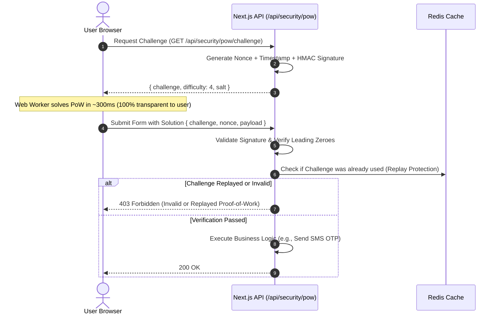

# Khodrekab Security Architecture & Zero-Trust Model

This document outlines the multi-layered security architecture, cryptographic mechanisms, anti-abuse protections, and operational controls implemented in **Khodrekab** (`khodrekab.ir`).

---

## 1. Security Philosophy: Defense in Depth

Khodrekab operates under a **Zero-Trust** security philosophy. Every client request is treated as potentially adversarial until authenticated and cryptographically validated. The defense-in-depth model spans five distinct layers:

```
[ Layer 1: Edge & Network ]        --> SSL/TLS 1.3, Strict CSP, Security Headers, IP Rate Limiter
[ Layer 2: Client Verification ]   --> Client-Side Proof-of-Work (PoW) SHA-256 Challenge
[ Layer 3: Application & Queue ]   --> Redis Sliding-Window Budget Caps, OTP Lockout Exponential Backoff
[ Layer 4: Cryptography & PII ]    --> AES-GCM-256 Phone Encryption, Blind HMAC Indexing
[ Layer 5: Data & Infrastructure ] --> Least-Privilege PostgreSQL Roles, Non-Root Container Execution
```

---

## 2. Client-Side Proof-of-Work (PoW) Challenge

To eliminate bot registrations, SMS balance depletion attacks, and automated scraping without subjecting real human users to annoying visual CAPTCHAs, Khodrekab implements an asymmetric cryptographic Proof-of-Work protocol.

### 2.1 Protocol Workflow
1. **Challenge Request:** Client calls `POST /api/security/pow/challenge`.
2. **Server Challenge Generation:** The server creates a cryptographically signed payload:
   $$\text{Challenge} = \text{HMAC-SHA256}(\text{timestamp} \parallel \text{nonce} \parallel \text{ip}, \text{POW\_SECRET\_PEPPER})$$
3. **Client Computation:** The client runs a Web Worker (or pure-JS fallback for older mobile devices) iterating nonces until:
   $$\text{SHA-256}(\text{Challenge} \parallel \text{client\_nonce}) \text{ starts with } N \text{ leading zeros}$$
4. **Server Verification:** The server re-computes the hash in under $0.1\text{ ms}$. If valid and within the 5-minute validity window, the request proceeds.



---

## 3. SMS Abuse Protection & Financial Circuit Breakers

SMS delivery in Iran carries real financial cost and strict carrier rate limits. Khodrekab enforces strict financial circuit breakers backed by atomic Redis operations (`src/lib/security/limiter.ts`):

| Protection Layer | Limit / Threshold | Mechanism | Action on Breach |
| :--- | :--- | :--- | :--- |
| **Per-IP Hourly Cap** | 20 SMS / hour per `/32` IP | Redis Sliding-Window Counter | Request dropped; HTTP 429 Too Many Requests |
| **Per-Phone Hourly Cap** | 10 SMS / hour per mobile number | Atomic Redis Key with 3600s TTL | Temporarily muted; HTTP 429 |
| **Per-Phone Daily Cap** | 10 SMS / 24 hours per mobile number | Atomic Redis Key with 86400s TTL | Lockout for remainder of the day |
| **Global Platform Cap** | 60 SMS / hour system-wide | Platform-level counter | Circuit breaker trips; notification to admin |
| **OTP Verification Lockout**| 10 invalid attempts | Redis tracking counter | 30-minute lockout on phone verification |
| **Emergency Kill Switch** | `SMS_KILL_SWITCH=true` | Server runtime environment check | Instant cut-off of outbound SMS dispatch |

---

## 4. Personally Identifiable Information (PII) Protection

Phone numbers are sensitive personal data. Khodrekab never stores plain-text phone numbers in application databases.

### 4.1 Cryptographic Storage (AES-GCM-256)
- **Encryption Algorithm:** AES-256-GCM with a 96-bit randomized Initialization Vector (IV) and a 128-bit authentication tag.
- **Key Derivation:** Sourced from `SMS_ENCRYPTION_KEY` configured via secure environment secrets.
- **At-Rest Format:** `iv:authTag:encryptedPayload` (Base64-encoded).

### 4.2 Blind Indexing for Performant Search
To allow fast lookups ($O(1)$) by phone number without decrypting all database rows:
$$\text{phoneHash} = \text{HMAC-SHA256}(\text{normalizedPhone}, \text{OTP\_PEPPER})$$
- Unique index on `phoneHash` ensures high database query performance and uniqueness constraints.
- Even if the database is compromised, phone numbers cannot be derived without the server's private pepper.

---

## 5. Database Least-Privilege Role Separation

PostgreSQL access is strictly split into two specialized roles to mitigate SQL injection blast radius (`prisma/bootstrap-roles.sql`):

```sql
-- Application runtime role (Limited to DML only)
GRANT CONNECT ON DATABASE carlanding TO carno_app;
GRANT USAGE ON SCHEMA public TO carno_app;
GRANT SELECT, INSERT, UPDATE, DELETE ON ALL TABLES IN SCHEMA public TO carno_app;
GRANT USAGE, SELECT ON ALL SEQUENCES IN SCHEMA public TO carno_app;

-- Revoke all administrative privileges from runtime role
REVOKE CREATE ON SCHEMA public FROM carno_app;
REVOKE DROP, TRUNCATE ON ALL TABLES IN SCHEMA public FROM carno_app;

-- Dedicated migration role (Used solely by CI/CD during deployment)
GRANT ALL PRIVILEGES ON DATABASE carlanding TO carno_migrator;
```

---

## 6. HTTP Headers & Content Security Policy (CSP)

Configured centrally in [next.config.ts](file:///Users/mahdi/Documents/DivarLanding/next.config.ts):

```typescript
const securityHeaders = [
  { key: "X-Frame-Options", value: "DENY" },
  { key: "X-Content-Type-Options", value: "nosniff" },
  { key: "Referrer-Policy", value: "strict-origin-when-cross-origin" },
  { key: "Permissions-Policy", value: "camera=(), microphone=(), geolocation=(), browsing-topics=()" },
  { key: "Strict-Transport-Security", value: "max-age=15552000" },
  { 
    key: "Content-Security-Policy-Report-Only", 
    value: "default-src 'self'; script-src 'self' 'unsafe-inline'; style-src 'self' 'unsafe-inline'; img-src 'self' data: blob:; font-src 'self'; connect-src 'self'; frame-ancestors 'none'; base-uri 'self'; form-action 'self';" 
  }
];
```

---

## 7. Automated Pre-Commit & CI Secret Scanning

To guarantee that no credentials, tokens, or private keys are ever committed to the repository:
1. **Local Pre-Commit Hook:** `.git/hooks/pre-commit` executes `gitleaks protect --staged` with Iranian bank card detection and n8n webhook rules. Any staged commit containing credentials is immediately aborted with exit code `1`.
2. **GitHub Actions CI Pipeline:** `.github/workflows/gitleaks.yml` scans every push and pull request against [.gitleaks.toml](file:///Users/mahdi/Documents/DivarLanding/.gitleaks.toml).
3. **Zero Secrets in History:** Production secrets (`.env`, `secrets/`, cookies, database backups) are permanently excluded from Git tracking via [.gitignore](file:///Users/mahdi/Documents/DivarLanding/.gitignore).
