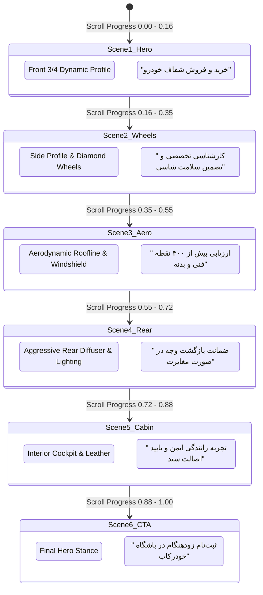
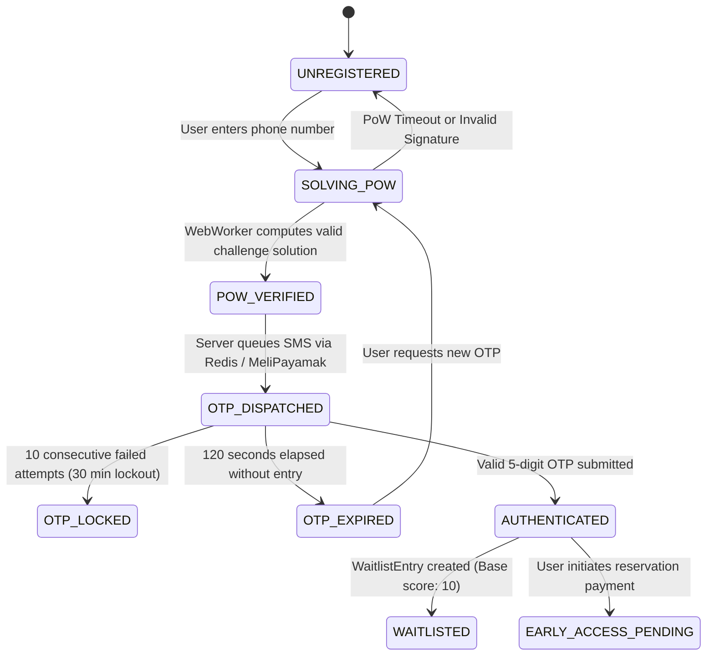

# Khodrekab State Machine Architecture

This document formalizes the finite state machines (FSM) governing interactive car scrubbing, progressive asset hydration, user onboarding, and payment processing in **Khodrekab**.

---

## 1. Interactive 360-Degree Scroller State Machine

The landing page experience synchronizes user scroll position with an HTML5 Canvas rendering a 120-frame WebP rotation sequence divided into 6 distinct narrative scenes.



---

## 2. Progressive Frame Loading State Machine

To guarantee instantaneous responsiveness on weak cellular networks (3G/4G), the frame loader operates as an autonomous state machine:

```mermaid
stateDiagram-v2
    [*] --> SSR_POSTER: Server renders eager Frame 1 <img>
    SSR_POSTER --> LOADING_ANCHORS: Client mounts, requests 5 Keyframes (1, 30, 60, 90, 120)
    LOADING_ANCHORS --> ANCHORS_READY: 5 Anchors decoded in memory (Canvas becomes interactive)
    
    ANCHORS_READY --> STRIDE_4: Ingest frames at interval of 4
    STRIDE_4 --> STRIDE_2: Ingest intermediate frames at interval of 2
    STRIDE_2 --> COMPLETE: All 120 frames in memory (100% fidelity)

    ANCHORS_READY --> DEGRADED_MODE: Memory Warning / Low Memory Device (<128MB budget)
    DEGRADED_MODE --> ANCHORS_READY: Purge intermediate frames; retain only 30 anchor frames
```



### Transition Guard Rules:
- **`SSR_POSTER` $\to$ `ANCHORS_READY`:** Must complete within 800ms on 4G. If network times out, nearest cached frame is displayed.
- **Interpolation Fallback:** While intermediate frames are downloading, the canvas engine automatically maps any scroll position to the nearest available frame index via `O(1)` binary lookup (`findNearestLoadedFrame`).

---

## 3. User Onboarding & OTP State Machine

Governs user authentication, Proof-of-Work verification, and waitlist registration:



---

## 4. Payment Intent Lifecycle State Machine

Khodrekab implements a high-reliability card-to-card and gateway payment reconciliation machine:

```mermaid
stateDiagram-v2
    [*] --> INTENT_CREATED: User clicks Reserve (Total = 299,000 + Unique Code)
    INTENT_CREATED --> COUNTDOWN_ACTIVE: 15-Minute Timer starts in UI

    COUNTDOWN_ACTIVE --> SMS_WEBHOOK_RECEIVED: Bank sends transaction SMS to n8n
    SMS_WEBHOOK_RECEIVED --> VERIFYING: Matches totalAmount + status == PENDING
    VERIFYING --> PAID: Transaction confirmed atomically; User status -> EARLY_ACCESS

    COUNTDOWN_ACTIVE --> EXPIRED: 15 minutes elapsed without matching transaction
    EXPIRED --> INTENT_CREATED: User generates fresh intent

    VERIFYING --> FAILED: Amount mismatch or invalid reference
    PAID --> REFUNDED: Admin initiates manual refund
```

### State Definitions & Persistence:
- **`INTENT_CREATED`:** Generates unique integer offset between `1` and `999` to distinguish concurrent deposits.
- **`COUNTDOWN_ACTIVE`:** UI maintains countdown with auto-polling every 5 seconds.
- **`PAID`:** Terminal state. Grants immediate access to the authenticated user dashboard and triggers a congratulatory SMS.
